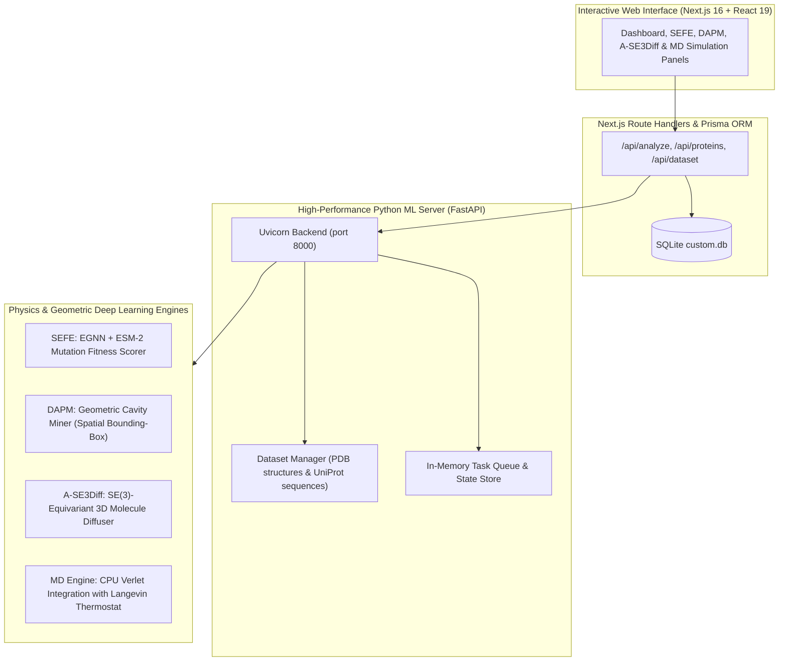

# ResistoDiff-3D 🧬

[](https://github.com/your-org/resistodiff-3d/actions)


> **ResistoDiff-3D** is a multi-scale structural physics and geometric deep learning platform for **Antimicrobial Resistance (AMR) Mutational Escape Prediction and De Novo Counter-Inhibitor Design**.

---

## 🔬 Scientific & Architectural Overview

Antimicrobial resistance (AMR) threatens global health as bacterial pathogens evolve mutations that abolish inhibitor binding while preserving catalytic efficiency. ResistoDiff-3D tackles this through an integrated pipeline comprising three primary engines and a real-time molecular dynamics simulation core:



### Core Modules

1. **SEFE (Structure-Equivariant Fitness Estimator):**
   - Utilizes an $E(n)$-Equivariant Graph Neural Network (EGNN) and ESM-2 sequence embeddings.
   - Evaluates thermodynamic stability ($\Delta\Delta G_{\text{fold}}$), active-site binding disruption ($\Delta\Delta G_{\text{binding}}$), and catalytic triad geometry to output epistatic fitness predictions for single and multi-point mutations.

2. **DAPM (Dynamic Allosteric Pocket Mapper):**
   - Employs an optimized spatial bounding-box grid algorithm and Shannon-entropy conservation scoring to identify cryptic and allosteric cavities across protein conformers.

3. **A-SE3Diff (Allosteric $\text{SE}(3)$-Equivariant Diffuser):**
   - Generates 3D molecular coordinates directly inside target pockets via continuous SE(3)-equivariant score matching with classifier-free guidance.
   - Evaluates candidate drug-likeness (QED, Lipinski Rule of 5 violations, Synthetic Accessibility).

4. **Interactive Molecular Dynamics Engine:**
   - Standalone Velocity Verlet integrator with Lennard-Jones, Coulombic electrostatic potentials, and harmonic bonds.
   - Real-time radius of gyration ($R_g$), contact topology, and Root Mean Square Fluctuation (RMSF) analysis.

---

## 🚀 Quickstart & Installation

### Prerequisites
- **Node.js**: `v20+` or `v24+`
- **Python**: `3.10+` or `3.12+`
- **Git**

### 1. Clone & Setup Python Virtual Environment
```bash
git clone https://github.com/your-org/resistodiff-3d.git
cd resistodiff-3d

# Create virtual environment
python -m venv venv

# Activate virtual environment
# Windows (PowerShell):
.\venv\Scripts\Activate.ps1
# Linux/macOS:
source venv/bin/activate

# Install dependencies
pip install -r python-backend/requirements.txt
```

### 2. Configure Environment & Database
```bash
# Copy example environment configuration
cp .env.example .env

# Install Node dependencies
npm install

# Initialize Prisma SQLite schema and seed targets
npx prisma generate
```

### 3. Running the Application

You can start both servers simultaneously:

**Terminal 1 — Python ML Backend:**
```bash
# With venv activated:
python -m uvicorn main:app --app-dir python-backend --host 127.0.0.1 --port 8000
```

**Terminal 2 — Next.js Frontend:**
```bash
npm run dev
```

Open [http://localhost:3000](http://localhost:3000) in your browser. The dashboard automatically monitors and reflects the connection status of the Python ML engine.

---

## 📡 API Reference

The Python backend exposes OpenAPI documentation at `http://localhost:8000/docs`.

| Method | Endpoint | Description |
| :--- | :--- | :--- |
| `GET` | `/api/health` | Backend and ML model health check |
| `GET` | `/api/targets` | List all curated AMR protein targets |
| `GET` | `/api/targets/{id}` | Retrieve target structure, known mutations, and annotations |
| `POST` | `/api/sefe/mutate` | Submit EGNN mutational fitness analysis task |
| `POST` | `/api/dapm/pockets` | Detect cryptic and allosteric pockets |
| `POST` | `/api/dapm/simulate` | Execute Velocity Verlet molecular dynamics simulation |
| `POST` | `/api/ase3diff/generate` | Generate 3D molecular counter-inhibitors in pocket |
| `POST` | `/api/ase3diff/score` | Compute ESM-2 protein-ligand binding affinity |
| `GET` | `/api/tasks/{task_id}` | Poll background task completion status and results |
| `GET` | `/api/dataset/status` | Dataset storage and cached PDB status |

---

## 🧪 Testing & Verification

ResistoDiff-3D includes automated test suites across both the Python ML engines and the Next.js API layer.

### Run Python Test Suite (Pytest)
```bash
.\venv\Scripts\python.exe -m pytest tests/ -v
```

### Run TypeScript & Lint Checks
```bash
npx tsc --noEmit
npx eslint .
```

### Production Build
```bash
npm run build
```

---

## 📁 Repository Structure

```
ResistoDiff-3D/
├── python-backend/               # FastAPI ML orchestration server
│   ├── config.py                 # Pydantic v2 settings & environment manager
│   ├── dataset_manager.py        # AMR bio-target caching & UniProt/RCSB sync
│   ├── main.py                   # FastAPI route handlers & task runner
│   └── requirements.txt          # Python dependencies
├── mini-services/resistodiff-engine/
│   ├── models/egnn.py            # Equivariant Graph Neural Network (EGNN)
│   ├── diffusion/se3_diffuser.py # SE(3) diffusion 3D molecular generator
│   ├── diffusion/esm_scorer.py   # ESM-2 protein-ligand binding scorer
│   ├── pockets/detector.py       # Spatial bounding-box pocket detector
│   └── simulation/md_engine.py   # Velocity Verlet MD engine & analyzer
├── src/
│   ├── app/                      # Next.js 16 App Router (pages & API proxies)
│   ├── components/resistodiff/   # UI Panels (Dashboard, SEFE, DAPM, A-SE3Diff, MD)
│   ├── hooks/                    # Responsive & UI utility hooks
│   └── lib/                      # Backend client, Prisma database client & utilities
├── tests/
│   ├── test_backend_api.py       # FastAPI integration and endpoint tests
│   └── test_ml_engines.py        # Algorithmic & physics validation tests
├── prisma/                       # Database schema & migrations (SQLite)
├── .github/workflows/ci.yml      # CI/CD Quality Gate workflow
└── package.json                  # Next.js dependencies & scripts
```

---

## 📄 License

This project is licensed under the [MIT License](LICENSE).
